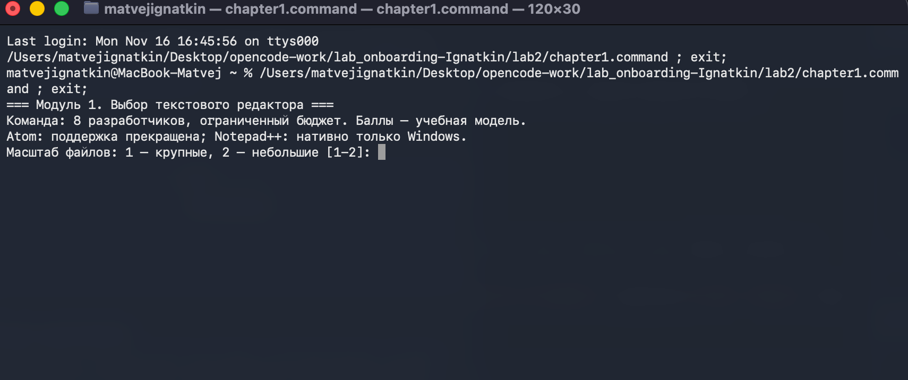
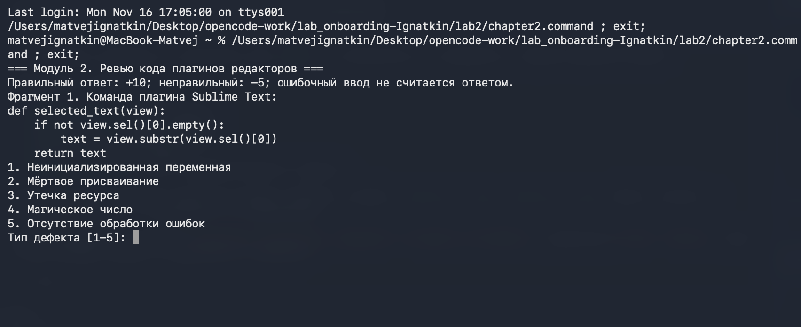
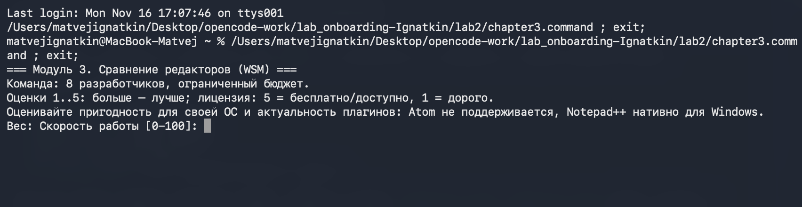
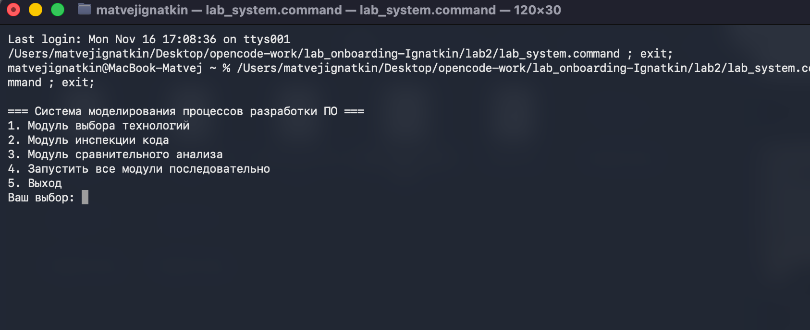
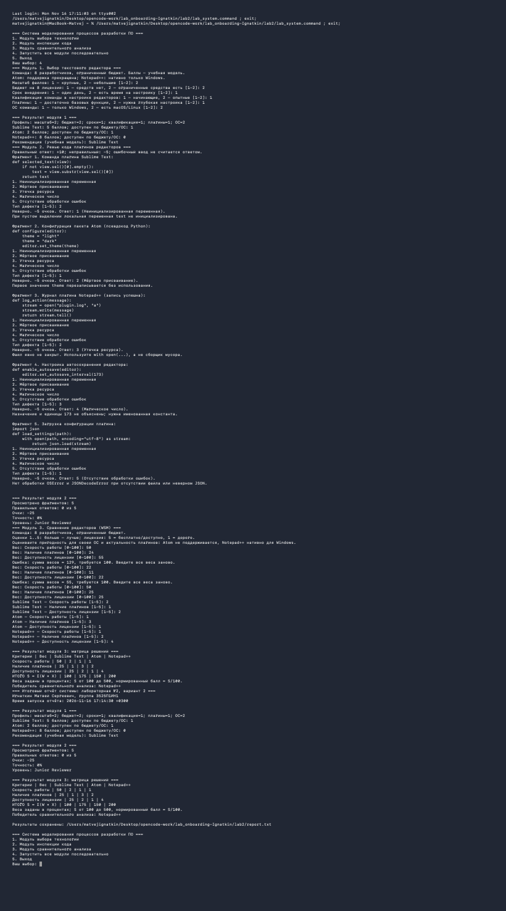

# lab_onboarding-Ignatkin

## Лабораторная работа №2

### Титульные данные

- **Студент:** Игнаткин Матвей Сергеевич.
- **Группа:** 3525П1ИН1.
- **Работа:** №2 — моделирование выбора технологий, ревьюирование и сравнительный анализ альтернатив.
- **Вариант:** 2 — выбор текстового редактора для команды из 8 разработчиков с ограниченным бюджетом.
- **Кандидаты:** Sublime Text, Atom, Notepad++.
- **Репозиторий:** https://github.com/doda123321/lab_onboarding-Ignatkin
- **Платформа:** macOS; с разрешения преподавателя вместо `.bat` используются `.command` на Bash.
- **Исходное задание:** [лабораторная работа 2.docx](лабораторная%20работа%202.docx).

Материалы предыдущей работы находятся в [client-check](client-check/README.md).

### Состав системы и запуск на Mac

| Файл | Назначение |
|---|---|
| [chapter1.command](lab2/chapter1.command) | Диалоги, числовой профиль проекта, рекомендация редактора |
| [chapter2.command](lab2/chapter2.command) | Пять фрагментов кода, классификация дефектов, метрики ревью |
| [chapter3.command](lab2/chapter3.command) | Веса, оценки, матрица решений и WSM |
| [lab_system.command](lab2/lab_system.command) | Меню и последовательный запуск с общим отчётом |
| [report.txt](lab2/report.txt) | Фактические результаты последнего завершённого запуска пункта 4 |

1. Скачайте или клонируйте репозиторий. Откройте папку `lab2` в Finder.
2. Дважды щёлкните по `lab_system.command`. Файл открывается в Terminal; если ассоциация другая, выберите «Открыть в программе → Терминал».
3. Введите номер пункта и нажмите Enter. Пункты 1–3 запускают отдельные модули, 4 — все три, 5 — выход.
4. Отдельный модуль также запускается двойным щелчком по его `.command`. После результата он ждёт Enter, чтобы можно было прочитать вывод.
5. После пункта 4 общий отчёт появляется в терминале и сохраняется рядом со скриптами, в `lab2/report.txt`. Следующий успешный полный запуск обновляет этот файл. Прерванный запуск сохраняет предыдущий отчёт.

Исполняемые права уже установлены. Если при копировании они потерялись, выполните в Terminal (подставьте свой путь):

```bash
chmod +x "/путь/к/репозиторию/lab2/"*.command
"/путь/к/репозиторию/lab2/lab_system.command"
```

Можно запускать из любой текущей папки, в том числе по пути с пробелами. Нужны только штатные `/bin/bash` и утилиты macOS; сами редакторы устанавливать не требуется. Фрагменты кода показываются как текст, а не исполняются. При закрытии входного потока (Ctrl+D) модуль сообщает о прерывании; меню на Ctrl+D завершает работу.

### Логика модулей и адаптация команд

Windows-команды заменены эквивалентами Bash: `choice`/`set /p` → `read` с проверкой, `set /a` → `$((...))`, `if` → `if`/`case`, `goto` → циклы и функции, `call` → запуск дочернего `.command`, `pause` → ожидание Enter при интерактивном запуске. Используется Bash 3.2, поставляемый с macOS.

**Модуль 1.** Шесть вопросов: размер файлов, средства на восемь лицензий, срок внедрения, квалификация, потребность в плагинах и ОС команды. Ответы 1/2 образуют числовой профиль. Прибавления баллов (S — Sublime Text, A — Atom, N — Notepad++):

| Вопрос | Ответ 1 | Ответ 2 |
|---|---|---|
| Размер файлов | Крупные: S+3, N+1 | Небольшие: A+2, N+2 |
| Бюджет | Нет средств: A+3, N+3 | Есть ограниченные средства: S+3 |
| Сроки | Один день: S+2, N+2 | Есть время: A+2 |
| Квалификация | Начинающие: N+2 | Опытные: S+1, A+2 |
| Плагины | Базовые функции: N+2 | Глубокая настройка: S+2, A+3 |
| ОС | Только Windows: все допустимы | Есть macOS/Linux: N исключается |

При отсутствии средств Sublime Text исключается из рекомендаций. Баллы показываются и для исключённых кандидатов, рядом выводится признак доступности 0/1. Максимум выбирается среди допустимых кандидатов; при равенстве перечисляются все лидеры. Это учебная эвристика, а не измерение качества продуктов. Atom сохранён по условию задания, но прекращение поддержки явно указано; при его выборе предлагается пересмотреть бюджет или список кандидатов для реального внедрения.

**Модуль 2.** В коде плагинов показаны все пять типов дефектов: неинициализированная переменная, мёртвое присваивание, утечка ресурса, магическое число и отсутствие обработки ошибок. Правильный ответ даёт +10 очков, неправильный −5. Неверный ввод не влияет на счёт. Точность равна `correct × 100 / total`; Senior — от 80%, Middle — от 50%, Junior — ниже 50%. Уровень определяется точностью, очки выводятся отдельно и могут быть отрицательными.

**Модуль 3.** Три критерия: скорость, плагины, доступность лицензии для команды. Все шкалы направлены одинаково: 5 — лучше, 1 — хуже; высокая стоимость лицензии означает низкую оценку доступности. Веса — целые 0–100, сумма строго 100. При ошибке суммы повторно вводятся все веса. Оценки — целые 1–5. До арифметики проверяется формат и длина строки, поэтому выражения, дроби, отрицательные значения и слишком длинные числа не исполняются и не приводят к переполнению. Ведущие нули допустимы и читаются в десятичной системе.

Используется `S = Σ(W × X)` с процентными весами: итог 100–500; деление на 100 даёт нормированный результат 1–5 и не меняет ранжирование. Выводятся матрица и все победители при ничьей. Оценки задаёт пользователь; WSM не наследует ограничения первого модуля, поэтому результаты двух методов могут различаться.

**Главный модуль.** Меню вызывает скрипты по абсолютному пути относительно собственной папки. Для каждого запуска создаётся временная папка с результатами. Через `LAB_RESULT` модуль получает путь для записи своего итогового блока, через `LAB_MENU=1` отключается лишняя пауза. Эти переменные при обычном запуске задавать не нужно. Пункт 4 собирает три блока именно текущего прохождения, показывает их и атомарно обновляет `report.txt`. Ошибка дочернего процесса останавливает сборку отчёта. Временная папка удаляется при выходе. Результаты не подменяются общими фразами «рекомендация сформирована».

### Листинги с пояснениями

Ниже приведены листинги модулей. Комментарии отмечают проверку ввода, расчёты и обмен результатами.

#### `chapter1.command`

`ask` принимает только 1/2; `eligible` отделяет ограничения от баллов, а цикл максимума сохраняет всех лидеров. `summary` используется и для экрана, и для передачи результата меню.

```bash
#!/bin/bash
# Вариант 2. Числовой профиль и учебная балльная модель выбора.
set -e
ask() {
    local value
    while true; do
        printf '%s [1-2]: ' "$1"
        if ! IFS= read -r value; then
            printf '\nВвод завершён. Модуль прерван.\n' >&2; exit 1
        fi
        case "$value" in 1|2) answer=$value; return;; esac
        printf 'Ошибка: введите 1 или 2.\n'
    done
}
pause_end() {
    if [[ -t 0 && ${LAB_MENU:-0} != 1 ]]; then
        read -r -p 'Нажмите Enter для закрытия...' || true
    fi
}
printf '=== Модуль 1. Выбор текстового редактора ===\n'
printf 'Команда: 8 разработчиков, ограниченный бюджет. Баллы — учебная модель.\n'
printf 'Atom: поддержка прекращена; Notepad++: нативно только Windows.\n'
score_sublime=0; score_atom=0; score_notepadpp=0
ask 'Масштаб файлов: 1 — крупные, 2 — небольшие'
scale=$answer
if [[ $scale == 1 ]]; then
    score_sublime=$((score_sublime+3)); score_notepadpp=$((score_notepadpp+1))
else
    score_atom=$((score_atom+2)); score_notepadpp=$((score_notepadpp+2))
fi
ask 'Бюджет на 8 лицензий: 1 — средств нет, 2 — ограниченные средства есть'
budget=$answer
if [[ $budget == 1 ]]; then
    score_atom=$((score_atom+3)); score_notepadpp=$((score_notepadpp+3))
else
    score_sublime=$((score_sublime+3))
fi
ask 'Срок внедрения: 1 — один день, 2 — есть время на настройку'
deadline=$answer
if [[ $deadline == 1 ]]; then
    score_sublime=$((score_sublime+2)); score_notepadpp=$((score_notepadpp+2))
else
    score_atom=$((score_atom+2))
fi
ask 'Квалификация команды в настройке редакторов: 1 — начинающие, 2 — опытные'
skill=$answer
if [[ $skill == 1 ]]; then
    score_notepadpp=$((score_notepadpp+2))
else
    score_sublime=$((score_sublime+1)); score_atom=$((score_atom+2))
fi
ask 'Плагины: 1 — достаточно базовых функций, 2 — нужна глубокая настройка'
plugins=$answer
if [[ $plugins == 1 ]]; then
    score_notepadpp=$((score_notepadpp+2))
else
    score_sublime=$((score_sublime+2)); score_atom=$((score_atom+3))
fi
ask 'ОС команды: 1 — только Windows, 2 — есть macOS/Linux'
platform=$answer
# Ограничения важнее баллов: лицензия и нативная совместимость.
names=('Sublime Text' 'Atom' 'Notepad++')
scores=("$score_sublime" "$score_atom" "$score_notepadpp")
eligible=(1 1 1)
[[ $budget != 1 ]] || eligible[0]=0
[[ $platform != 2 ]] || eligible[2]=0
best=-1; winners=''; count=0
for i in 0 1 2; do
    [[ ${eligible[$i]} == 1 ]] || continue
    if (( scores[i] > best )); then
        best=${scores[$i]}; winners=${names[$i]}; count=1
    elif (( scores[i] == best )); then
        winners="$winners, ${names[$i]}"; count=$((count+1))
    fi
done
summary() {
    printf '\n=== Результат модуля 1 ===\n'
    printf 'Профиль: масштаб=%s; бюджет=%s; сроки=%s; квалификация=%s; плагины=%s; ОС=%s\n' "$scale" "$budget" "$deadline" "$skill" "$plugins" "$platform"
    for i in 0 1 2; do
        printf '%s: %s баллов; доступен по бюджету/ОС: %s\n' "${names[$i]}" "${scores[$i]}" "${eligible[$i]}"
    done
    printf 'Рекомендация (учебная модель): %s\n' "$winners"
    if (( count > 1 )); then printf 'Равенство баллов: единственного победителя нет. Нужен пробный запуск.\n'; fi
    if [[ $winners == *Atom* ]]; then
        printf 'Atom не поддерживается: для реального внедрения пересмотрите бюджет или список кандидатов.\n'
    fi
}
summary
if [[ -n ${LAB_RESULT:-} ]]; then summary > "$LAB_RESULT"; fi
pause_end
```

#### `chapter2.command`

`review` показывает один и тот же классификатор для каждого фрагмента, повторяет неверный ввод и объясняет ответ. Счёт и точность рассчитываются по реально введённым ответам.

```bash
#!/bin/bash
# Фрагменты стилизованы под Python-код плагинов редакторов; не исполняются.
set -e
correct=0; points=0; total=5
types=('Неинициализированная переменная' 'Мёртвое присваивание' 'Утечка ресурса' 'Магическое число' 'Отсутствие обработки ошибок')
review() {
    local expected=$1 explanation=$2 value i
    for i in 0 1 2 3 4; do printf '%s. %s\n' "$((i+1))" "${types[$i]}"; done
    while true; do
        printf 'Тип дефекта [1-5]: '
        if ! IFS= read -r value; then
            printf '\nВвод завершён. Модуль прерван.\n' >&2; exit 1
        fi
        case "$value" in [1-5]) break;; esac
        printf 'Ошибка: введите целое число от 1 до 5.\n'
    done
    if [[ $value == "$expected" ]]; then
        correct=$((correct+1)); points=$((points+10))
        printf 'Верно! +10 очков.\n'
    else
        points=$((points-5))
        printf 'Неверно. -5 очков. Ответ: %s (%s).\n' "$expected" "${types[$((expected-1))]}"
    fi
    printf '%s\n\n' "$explanation"
}
printf '=== Модуль 2. Ревью кода плагинов редакторов ===\n'
printf 'Правильный ответ: +10; неправильный: -5; ошибочный ввод не считается ответом.\n'
printf '%s\n' 'Фрагмент 1. Команда плагина Sublime Text:' \
    'def selected_text(view):' \
    '    if not view.sel()[0].empty():' \
    '        text = view.substr(view.sel()[0])' \
    '    return text'
review 1 'При пустом выделении локальная переменная text не инициализирована.'
printf '%s\n' 'Фрагмент 2. Конфигурация пакета Atom (псевдокод Python):' \
    'def configure(editor):' \
    '    theme = "light"' \
    '    theme = "dark"' \
    '    editor.set_theme(theme)'
review 2 'Первое значение theme перезаписывается без использования.'
printf '%s\n' 'Фрагмент 3. Журнал плагина Notepad++ (запись успешна):' \
    'def log_action(message):' \
    '    stream = open("plugin.log", "a")' \
    '    stream.write(message)' \
    '    return stream.tell()'
review 3 'Файл явно не закрыт. Используйте with open(...), а не сборщик мусора.'
printf '%s\n' 'Фрагмент 4. Настройка автосохранения редактора:' \
    'def enable_autosave(editor):' \
    '    editor.set_autosave_interval(173)'
review 4 'Назначение и единицы 173 не объяснены; нужна именованная константа.'
printf '%s\n' 'Фрагмент 5. Загрузка конфигурации плагина:' \
    'import json' \
    'def load_settings(path):' \
    '    with open(path, encoding="utf-8") as stream:' \
    '        return json.load(stream)'
review 5 'Нет обработки OSError и JSONDecodeError при отсутствии файла или неверном JSON.'
percentage=$((correct*100/total))
if (( percentage >= 80 )); then level='Senior Reviewer'
elif (( percentage >= 50 )); then level='Middle Reviewer'
else level='Junior Reviewer'; fi
summary() {
    printf '\n=== Результат модуля 2 ===\n'
    printf 'Просмотрено фрагментов: %s\nПравильных ответов: %s из %s\nОчки: %s\nТочность: %s%%\nУровень: %s\n' "$total" "$correct" "$total" "$points" "$percentage" "$level"
}
summary
if [[ -n ${LAB_RESULT:-} ]]; then summary > "$LAB_RESULT"; fi
if [[ -t 0 && ${LAB_MENU:-0} != 1 ]]; then
    read -r -p 'Нажмите Enter для закрытия...' || true
fi
```

#### `chapter3.command`

`number` проверяет строку до вычислений; массив `ratings` хранит матрицу по строкам альтернатив. Максимум ищется без потери равных результатов.

```bash
#!/bin/bash
# WSM: целые веса 0..100, оценки 1..5; больше всегда лучше.
set -e
number() {
    local value
    while true; do
        printf '%s [%s-%s]: ' "$1" "$2" "$3"
        if ! IFS= read -r value; then
            printf '\nВвод завершён. Модуль прерван.\n' >&2; exit 1
        fi
        # Проверка до арифметики: исключаем выражения, переполнение, дроби.
        if [[ $value =~ ^[0-9]{1,3}$ ]]; then
            answer=$((10#$value))
            if (( answer >= $2 && answer <= $3 )); then return; fi
        fi
        printf 'Ошибка: требуется целое число от %s до %s.\n' "$2" "$3"
    done
}
names=('Sublime Text' 'Atom' 'Notepad++')
criteria=('Скорость работы' 'Наличие плагинов' 'Доступность лицензии')
printf '=== Модуль 3. Сравнение редакторов (WSM) ===\n'
printf 'Команда: 8 разработчиков, ограниченный бюджет.\n'
printf 'Оценки 1..5: больше — лучше; лицензия: 5 = бесплатно/доступно, 1 = дорого.\n'
printf 'Оценивайте пригодность для своей ОС и актуальность плагинов: Atom не поддерживается, Notepad++ нативно для Windows.\n'
while true; do
    for k in 0 1 2; do
        number "Вес: ${criteria[$k]}" 0 100; weights[$k]=$answer
    done
    sum=$((weights[0]+weights[1]+weights[2]))
    if (( sum == 100 )); then break; fi
    printf 'Ошибка: сумма весов = %s, требуется 100. Введите все веса заново.\n' "$sum"
done
best=-1; winners=''; count=0
for i in 0 1 2; do
    scores[$i]=0
    for k in 0 1 2; do
        number "${names[$i]} — ${criteria[$k]}" 1 5
        ratings[$((i*3+k))]=$answer
        scores[$i]=$((scores[i]+weights[k]*answer))
    done
    if (( scores[i] > best )); then
        best=${scores[$i]}; winners=${names[$i]}; count=1
    elif (( scores[i] == best )); then
        winners="$winners, ${names[$i]}"; count=$((count+1))
    fi
done
summary() {
    printf '\n=== Результат модуля 3: матрица решений ===\n'
    printf 'Критерий | Вес | Sublime Text | Atom | Notepad++\n'
    for k in 0 1 2; do
        printf '%s | %s | %s | %s | %s\n' "${criteria[$k]}" "${weights[$k]}" "${ratings[$k]}" "${ratings[$((3+k))]}" "${ratings[$((6+k))]}"
    done
    printf 'ИТОГО S = Σ(W × X) | 100 | %s | %s | %s\n' "${scores[0]}" "${scores[1]}" "${scores[2]}"
    printf 'Веса заданы в процентах; S от 100 до 500, нормированный балл = S/100.\n'
    printf 'Победитель сравнительного анализа: %s\n' "$winners"
    if (( count > 1 )); then printf 'Равенство баллов: все перечисленные альтернативы делят первое место.\n'; fi
}
summary
if [[ -n ${LAB_RESULT:-} ]]; then summary > "$LAB_RESULT"; fi
if [[ -t 0 && ${LAB_MENU:-0} != 1 ]]; then
    read -r -p 'Нажмите Enter для закрытия...' || true
fi
```

#### `lab_system.command`

`DIR` обеспечивает независимость от рабочей папки, `run_module` передаёт путь для результата, а пункт 4 собирает полный отчёт до замены предыдущего файла.

```bash
#!/bin/bash
# Пути привязаны к скрипту, а результаты — к конкретному полному запуску.
set -e
DIR=$(cd "$(dirname "$0")" && pwd)
session=$(mktemp -d "$DIR/.session.XXXXXX")
trap 'rm -rf "$session"' EXIT
trap 'exit 130' INT
trap 'exit 143' TERM
run_module() {
    local status=0
    LAB_MENU=1 LAB_RESULT="$session/result$1.txt" "$DIR/chapter$1.command" || status=$?
    if (( status != 0 )); then
        printf 'Модуль %s прерван (код %s).\n' "$1" "$status" >&2
        return "$status"
    fi
}
while true; do
    printf '\n=== Система моделирования процессов разработки ПО ===\n'
    printf '1. Модуль выбора технологий\n2. Модуль инспекции кода\n3. Модуль сравнительного анализа\n4. Запустить все модули последовательно\n5. Выход\nВаш выбор: '
    if ! IFS= read -r choice; then printf '\nВвод завершён. Выход.\n'; exit 0; fi
    case "$choice" in
        1|2|3) run_module "$choice" || exit 1;;
        4)
            for module in 1 2 3; do run_module "$module" || exit 1; done
            # Сначала собираем полный отчёт, затем атомарно заменяем предыдущий.
            {
                printf '=== Итоговый отчёт системы: лабораторная №2, вариант 2 ===\n'
                printf 'Игнаткин Матвей Сергеевич, группа 3525П1ИН1\n'
                printf 'Время запуска отчёта: %s\n' "$(date '+%Y-%m-%d %H:%M:%S %z')"
                for module in 1 2 3; do
                    while IFS= read -r line; do printf '%s\n' "$line"; done < "$session/result$module.txt"
                done
            } > "$session/report.txt"
            mv -f "$session/report.txt" "$DIR/report.txt"
            while IFS= read -r line; do printf '%s\n' "$line"; done < "$DIR/report.txt"
            printf '\nРезультаты сохранены: %s/report.txt\n' "$DIR"
            ;;
        5) printf 'Работа завершена.\n'; exit 0;;
        *) printf 'Ошибка: выберите пункт от 1 до 5.\n';;
    esac
done
```

### Фактический контрольный запуск интегрированной системы

Проверка выполнена на macOS 26.7.1 (Darwin, arm64), штатный Bash 3.2.57. Это технический контроль на заданных тестовых ответах, а не личное прохождение студента.

Для воспроизведения выберите пункт **4** и вводите каждое число с Enter:

1. Модуль 1: **1, 2, 1, 2, 2, 2** — крупные файлы, ограниченные средства на лицензии, один день на внедрение, опытная команда, глубокая настройка, наличие macOS/Linux.
2. Модуль 2: **1, 2, 3, 4, 5** — все пять дефектов классифицированы правильно.
3. Модуль 3: веса **40, 30, 30**; оценки Sublime Text **5, 4, 2**, Atom **2, 5, 5**, Notepad++ **4, 3, 5**.

Получено:

- Модуль 1: Sublime Text — **11**, Atom — **5**, Notepad++ — **3** балла; рекомендация **Sublime Text**. Notepad++ исключён по ОС.
- Модуль 2: просмотрено **5** фрагментов, верно **5 из 5**, **50** очков, **100%**, **Senior Reviewer**.
- Модуль 3: **380 / 380 / 400**, победитель **Notepad++**. Эти оценки заданы для проверки арифметики; высокий WSM не отменяет ограничения по ОС из модуля 1.

Приведённые выше результаты относятся к техническому контрольному запуску. Его отчёт был сверен с итоговым блоком в консоли.

### Результаты самостоятельного прохождения

В [report.txt](lab2/report.txt) опубликованы результаты последующего запуска студента от **16.11.2026, 17:14:30 +0300**:

- Модуль 1: профиль **2, 2, 1, 1, 1, 2**; Sublime Text — **5**, Atom — **2**, Notepad++ — **8** баллов. Notepad++ исключён по ОС, рекомендация — **Sublime Text**.
- Модуль 2: просмотрено **5** фрагментов, правильных ответов **0 из 5**, **−25** очков, точность **0%**, уровень **Junior Reviewer**.
- Модуль 3: веса **50, 25, 25**; оценки Sublime Text — **2, 1, 2**, Atom — **1, 3, 1**, Notepad++ — **1, 2, 4**. Итоговые баллы — **175 / 150 / 200**, победитель — **Notepad++**.

Файл содержит ФИО, группу, время, профиль и баллы первого модуля, метрики второго, матрицу и победителя третьего. Следующее полное прохождение обновит его.

### Проверки

- **86 автоматических запусков** из `/tmp`: отдельные модули, пункты меню 1–5, возврат в меню, полный последовательный запуск.
- Проверены все **64** комбинации ответов модуля 1, включая равенство лидеров.
- Проверены Senior/Middle/Junior, штрафы и отрицательный итоговый счёт в модуле 2.
- Проверены ошибочная сумма весов, нулевые веса, ведущие нули, оценки вне диапазона, пустые строки, буквы, дроби, отрицательные и чрезмерно длинные числа, арифметические выражения и текст команд.
- Проверены ничьи двух и трёх альтернатив в WSM и точные итоговые баллы.
- Проверены конец ввода, прерывание последовательного прохождения и сохранность предыдущего отчёта, удаление временной папки.
- Все четыре файла прошли `bash -n` и имеют права исполнения.
- Дополнительно **4 запуска в псевдотерминале** подтвердили интерактивный режим и ожидание Enter в каждом отдельном модуле.
- Двойной щелчок в Finder и внешний вид окна Terminal требуют ручной проверки пользователем; автоматическая проверка запускала те же исполняемые файлы напрямую на macOS.

### Скриншоты работы системы

Скриншоты предоставлены студентом после самостоятельного запуска.

#### Модуль 1 — выбор редактора



#### Модуль 2 — инспекция кода



#### Модуль 3 — сравнительный анализ



#### Главное меню



#### Последовательный запуск — итоговый отчёт



### Личные впечатления студента

**Предлагаемый текст для подтверждения студентом:**

«Главное меню позволяет последовательно пройти все этапы и увидеть результаты в одном отчёте. Сравнение показало, что рекомендация зависит не только от баллов, но и от ограничений: Notepad++ получил высокий результат, однако в первом модуле был исключён из-за ОС команды. Результат ревью показывает, что стоит дополнительно разобрать типы дефектов и пояснения к ответам. В дальнейшем систему можно улучшить, добавив больше фрагментов кода для тренировки».
